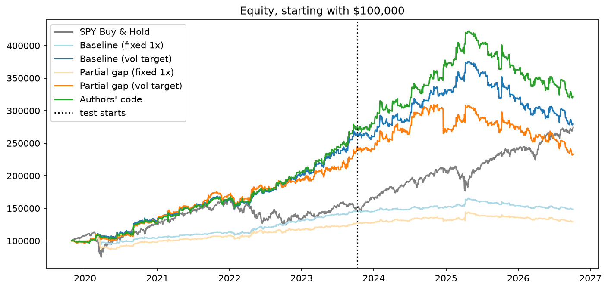
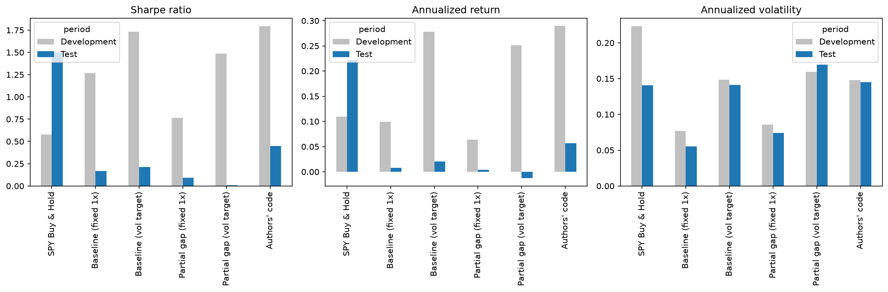
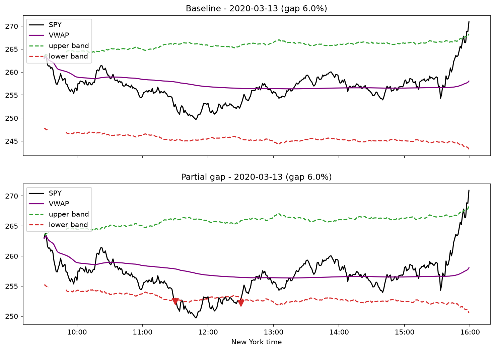

# SPY Intraday Momentum - WUTIS Case Study

Backtest of the intraday momentum strategy from *Beat the Market: An Effective Intraday Momentum
Strategy for S&P500 ETF (SPY)* (Zarattini, Aziz, Barbon, 2025), plus my own modification:
**Partial Overnight-Gap Adjustment** (use 50% of the overnight gap instead of 100%).

## Setup

Python 3.13 (tested with 3.13.14):

```bash
python -m venv .venv
.venv\Scripts\activate          
pip install -r requirements.txt
```

The data is already in `data/`, so no API key is needed to run the backtest.

```bash
python backtest.py              # prints the results table and saves results/*.csv
jupyter notebook analysis.ipynb # tables and charts
```

To download the data again you need a free Alpaca account: rename `.env.example` to `.env`,
add your keys and run `python download_data.py`.

## Project structure

| File / folder | What it is |
|---|---|
| `backtest.py` | All the strategy logic: indicators, signals, backtest loop, metrics |
| `analysis.ipynb` | Runs the backtest and shows the tables and charts |
| `download_data.py` | Downloads 1-minute SPY bars and dividends from Alpaca |
| `data/spy_1min.csv` | SPY 1-minute bars, 09:30-15:59 New York time, 2019-10-07 to 2026-10-06 (raw prices) |
| `data/spy_dividends.csv` | SPY cash dividends (ex-date, amount) |
| `results/` | `performance.csv`, `daily.csv`, `trades.csv` and the charts |

`backtest.py` is ordered top to bottom: settings --> data and indicators --> signals --> backtests --> results.

## The strategy

The idea of the paper: if SPY moves unusually far from its open, there is probably a buying or selling
imbalance that continues during the day. The "noise area" defines what a normal move is.

**Noise area.** For every minute of the day, `sigma` is the average absolute move from the open
at that same minute over the previous 14 days. The bands start from the open or from yesterday's close
(whichever is further away), so an overnight gap makes the noise area wider in that direction:

```
UB = max(open, prev_close) * (1 + sigma)
LB = min(open, prev_close) * (1 - sigma)
```

`prev_close` is yesterday's close minus today's dividend, because SPY drops by the dividend on the ex-date.

**VWAP.** The paper doesn't say exactly how VWAP is calculated, so I took the formula from the authors'
earlier VWAP paper (Zarattini & Aziz, 2023): cumulative `(high+low+close)/3 * volume` divided by cumulative
volume, reset every day.

**Signals.** Every 30 minutes (10:00 to 15:30): long if price > UB and > VWAP, short if price < LB and
< VWAP, otherwise flat. An opposite signal reverses the position. Everything is closed at the end of the day.

```python
long = (price > upper) & (price > vwap)
short = (price < lower) & (price < vwap)
```

**Sizing.** Volatility targeting like in the paper: `leverage = min(4, 2% / daily_vol)` and
`shares = round(equity / open * leverage)`. As a control I also run every strategy with a fixed 1x leverage.

**My modification - partial gap.** Only half of the overnight gap moves the bands:

```python
upper = day_open + gap_weight * max(prev_close - day_open, 0)
lower = day_open - gap_weight * max(day_open - prev_close, 0)
```

With `gap_weight = 1` this is exactly the paper. With `0.5` the band on the gap side is closer to the open.
Hypothesis: after a gap the strategy can catch a reversal earlier, but it may also get more false signals.

## Chronology

**1. Reading the paper.** I went through the noise area, entry/exit rules, VWAP and sizing.
The VWAP formula came from the authors' 2023 VWAP paper. Then I came up with the partial-gap idea (λ = 0.5).

**2. First version.** I wrote the backtest with Polygon/Massive minute data for October 2024 - October 2026.
I first used fixed 1x leverage for both strategies, to compare only the signals. The results were negative:
Sharpe -0.39 for the original strategy and -1.11 for partial gap. With volatility targeting
(2% target, max 4x) the test period February-October 2026 returned -8.72% (baseline) and -12.79% (partial gap).
That made me check whether my code was wrong.

**3. Checking my code against the authors' code.** I compared my implementation with the authors' public
Python code step by step: input data, noise area, VWAP, signals, positions, costs, P&L.
The differences came from a few conventions, not from wrong formulas:

- Noise area: I require all 14 previous days, the authors accept 13.
- Execution: I use the signal from the finished bar and trade at the open of the next minute.
  The authors calculate P&L from the signal bar's close.
- Costs: I add $0.001/share slippage on top of the $0.0035/share commission (min $0.35 per order).
- Dividends: yesterday's close is adjusted for the dividend on ex-dates.
- Benchmark: SPY buy & hold with cash dividends, whole shares and the same costs.

**4. Same period as the paper.** To see if the bad results came from my code or from the market,
I downloaded Alpaca SIP data for the authors' period (9 May 2022 - 22 April 2024):

| Implementation | Total return | Sharpe |
|---|---:|---:|
| Published by the authors | +79.00% | 2.42 |
| Authors' code on Alpaca data | +77.82% | 2.40 |
| My code on Alpaca data | +64.23% | 2.13 |

This showed me that my implementation does not return extremely different results, therefore, the problem is not my code. The gap to the authors comes from my more conservative assumptions (slippage, stricter noise window, next-minute execution), and I decided not to tune it to their numbers. It was more than enough for me to see that my code acts similarly to the Authors'.

**5. Longer sample.** I extended the Alpaca SIP data to 7 October 2019 - 6 October 2026. The stored CSV contains 685,246 minute bars across 1,759 trading days. Before backtesting, I filter the bars to official NYSE session hours, including the 13:00 close on early-close days. This leaves 683,425 session bars. There are 65 missing minutes within scheduled sessions: 56 during the March 2020 trading halts and 9 on 5 May 2021 and 5 June 2023. I leave those gaps unfilled.

**6. Development vs. test.** The sample is split by time:

- **Development** - Oct 2019 to Oct 2023 (4 years): checking the code and first comparison.
- **Test** - Oct 2023 to Oct 2026 (3 years): the same rules on later data.

λ = 0.5 was not optimized on the test data. Indicators only use past data. I had already looked at parts of
this history before, so the test is retrospective, not a completely untouched holdout.

I compare SPY buy & hold and the baseline and partial gap, each with fixed 1x and with volatility
targeting. This separates two effects: baseline vs partial gap (signals) and fixed vs vol target (sizing).
The authors' code is also run on the same data as a reference (commission only, no slippage).

## Results

All rows except "Authors' code" include commission and slippage. Starting capital $100,000.

| Strategy | Development 2019-2023 | Test 2023-2026 | Test Sharpe | Test trades |
|---|---:|---:|---:|---:|
| Baseline - fixed 1x | +45.29% | +2.33% | 0.17 | 668 |
| Partial gap - fixed 1x | +27.72% | +1.19% | 0.09 | 773 |
| Baseline - vol target | +163.37% | +6.11% | 0.21 | 668 |
| Partial gap - vol target | +142.07% | -3.82% | 0.01 | 773 |
| Authors' code | +172.81% | +17.78% | 0.45 | 690 |
| SPY Buy & Hold | +50.84% | +81.76% | 1.50 | - |

Full table with annualized return, volatility, Sharpe and drawdown: `results/performance.csv`.




Development and test look very different. In development the baseline beat the partial gap by 21.30
percentage points (vol target). In the test period the baseline was ahead by 9.93 points,
and the same happened with fixed 1x. The partial gap changed 358 of 8480 test signals, entered earlier on
60 of 455 days when both traded, and made more trades (773 vs 668), so it also paid more costs
($8,664 vs $8,490).

Example of the two strategies on the day with the largest gap where their signals differ (2020-03-13):



## Conclusion

Over the full seven years the original strategy with volatility targeting made +179.47% and the partial gap
+132.82%. So my hypothesis is only partly confirmed: using half of the gap does change the signals and
sometimes helps, but it doesn't give a stable advantage. Earlier entries can catch a move, but they also
bring more false signals and costs.

The difference between development and test also shows why a strategy shouldn't be judged only on the
period it was built on. In the test period both versions were far behind simply holding SPY.

**Limitations:** one ETF and one sample; minute bars don't capture spreads, latency or market impact;
financing, short borrow costs and interest on cash are ignored, which matters with leverage up to 4x.

## Further Discussion: The Post-2025 Drawdown

Both the baseline and partial-gap strategies experienced a prolonged drawdown around 2025, even as SPY recovered from the April tariff-related sell-off and continued rising. One possible explanation is weaker intraday momentum: after breaking the Noise Area boundaries, prices may have reversed more frequently instead of continuing in the same direction, causing false signals and losses. 

SPY's overall growth also does not guarantee intraday profits, since part of its returns can occur overnight, when the strategy holds no positions. Volatility-targeted sizing may have amplified losses as leverage increased again when volatility declined. These are possible explanations, not confirmed causes.

My Partial Gap modification was intended to address one related issue: the original strategy may react too slowly when SPY reverses an overnight gap. By reducing the gap adjustment from 100% to 50%, it allows earlier entries into such reversals. However, earlier entries can also produce more false signals. Partial Gap did not demonstrate a consistent improvement or solve the deterioration observed around 2025.
## References

1. Zarattini, C., Aziz, A. & Barbon, A. (2025). *Beat the Market: An Effective Intraday Momentum Strategy for S&P500 ETF (SPY).*
2. Zarattini, C. & Aziz, A. (2023). *Volume Weighted Average Price (VWAP): The Holy Grail for Day Trading Systems.*
3. Concretum Group - Python backtest of the paper (the authors' code).
